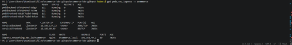
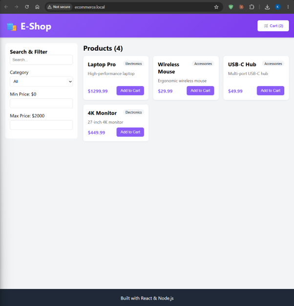
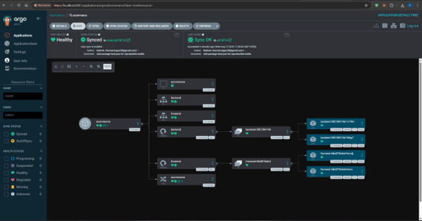
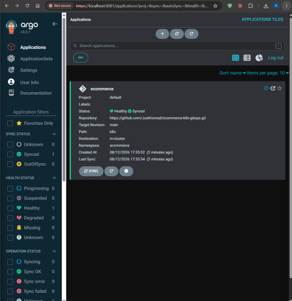
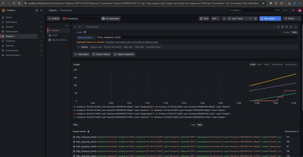
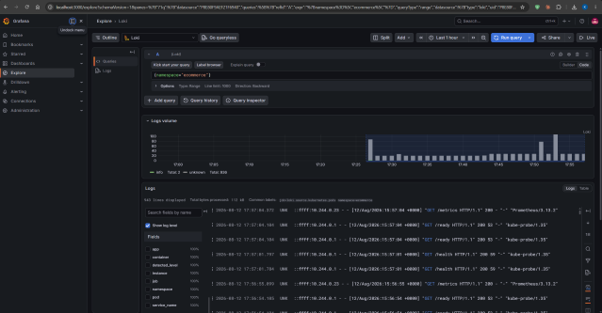
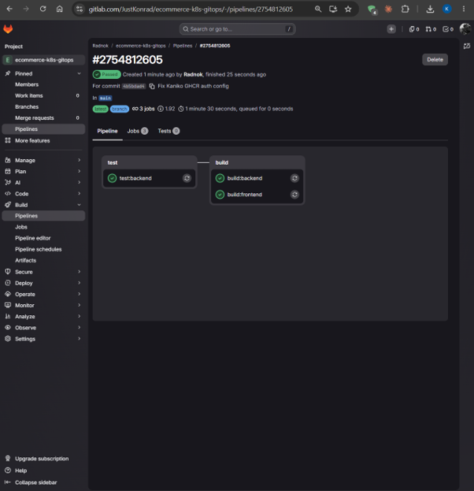

# 🛍️ E-Commerce sur Kubernetes — DevOps & GitOps

> **Projet M2 — Déployer une application complète sur K8S-t3**
> Déploiement d'une application e-commerce (React + Node.js/Express) sur Kubernetes,
> avec pipeline CI/CD automatisé, gestion GitOps (ArgoCD) et observabilité complète (LGTM + Alloy).

**Auteur :** Konrad Sagan
**Repository (code + manifests + rapport) :** https://github.com/JustKonrad/ecommerce-k8s-gitops
**Pipeline CI/CD (GitLab) :** https://gitlab.com/JustKonrad/ecommerce-k8s-gitops/-/pipelines

---

## 1. Sommaire

1. Architecture générale
2. Arborescence du dépôt
3. Prérequis
4. Étape 1 — Images Docker (build & push GHCR)
5. Étape 2 — Déploiement Kubernetes
6. Étape 3 — GitOps avec ArgoCD
7. Étape 4 — Monitoring LGTM + Alloy
8. Étape 5 — Pipeline CI/CD (GitLab)
9. Choix techniques & sécurité
10. Limites connues & évolutions
11. Correspondance avec le barème

---

## 2. Architecture générale

L'application est composée d'un **frontend React** (servi par nginx) et d'un **backend Node.js/Express**
exposant une API REST de gestion de produits. Le tout est déployé sur Kubernetes, exposé via un Ingress,
synchronisé depuis Git par ArgoCD, et observé par une stack LGTM + Alloy.

```
                        Navigateur
                            |  http://ecommerce.local
                            v
                   +------------------+
                   |  Ingress (nginx) |
                   +--------+---------+
                 /          |          /api
        +--------v------+   +------v----------+
        |  Service      |          | Service   |
        |  frontend:80  |          | backend:3001
        +-------+-------+          +-----+-----+
                |                        |
        +-------v--------+       +-------v---------+
        | Deployment     |       | Deployment      |
        | frontend (x2)  |       | backend (x2)    |
        | nginx :8080    |       | node/express    |
        +----------------+       +-------+---------+
                                         | /metrics
                                         v
   Observabilite (namespace: monitoring)
   +-----------+---------+--------+-------+----------+
   | Prometheus|  Loki   | Tempo  | Alloy | Grafana  |
   |   (M)     |  (L)    |  (T)   |  (A)  |   (G)    |
   +-----------+---------+--------+-------+----------+
```

**Principe GitOps :** un `git push` sur le dossier `k8s/` est détecté par ArgoCD, qui synchronise
automatiquement le cluster (options `prune` + `selfHeal`). Git est l'unique source de vérité.

**Chaîne d'observabilité :** Alloy collecte les logs de tous les pods puis les envoie à Loki. Prometheus
scrape `/metrics` du backend via un ServiceMonitor. Grafana lit Prometheus, Loki et Tempo comme datasources.

---

## 3. Arborescence du dépôt

```
.
├── backend/            # API Node.js/Express (+ Dockerfile multi-stage)
│   ├── src/index.js    # API produits + métriques Prometheus + health/ready
│   ├── tests/          # Tests Jest + Supertest
│   └── Dockerfile
├── frontend/           # SPA React (+ Dockerfile multi-stage nginx)
│   ├── src/
│   ├── nginx.conf
│   └── Dockerfile
├── k8s/                # Manifests Kubernetes (source de vérité GitOps)
│   ├── 00-namespace.yaml
│   ├── 10-backend-deployment.yaml
│   ├── 11-backend-service.yaml
│   ├── 20-frontend-deployment.yaml
│   ├── 21-frontend-service.yaml
│   ├── 30-ingress.yaml
│   └── kustomization.yaml
├── argocd/
│   └── application.yaml   # Application ArgoCD (auto-sync)
├── monitoring/           # Stack LGTM + Alloy (Helm values)
│   ├── values-kube-prometheus-stack.yaml
│   ├── values-loki.yaml
│   ├── values-tempo.yaml
│   ├── values-alloy.yaml
│   ├── servicemonitor-backend.yaml
│   └── install.sh
├── .gitlab-ci.yml        # Pipeline CI/CD (test -> build -> push GHCR)
├── docker-compose.yml    # Lancement local sans K8s (dev)
├── screenshots/          # Captures des résultats (ce rapport)
└── README.md             # Ce rapport
```

---

## 4. Prérequis

- Docker Desktop
- Minikube v1.30+ / kubectl v1.27+ / Helm v3.x

Démarrage du cluster (driver Docker) :

```bash
minikube start --cpus=4 --memory=8g --driver=docker
minikube addons enable ingress
```

---

## 5. Étape 1 — Images Docker (build & push GHCR)

Les deux images sont publiées sur **GitHub Container Registry (ghcr.io)**, en accès public
pour permettre au cluster de les tirer sans `imagePullSecret`.

```bash
echo $GHCR_TOKEN | docker login ghcr.io -u justkonrad --password-stdin

# Backend
docker build -t ghcr.io/justkonrad/ecommerce-backend:latest ./backend
docker push ghcr.io/justkonrad/ecommerce-backend:latest

# Frontend (URL de l'API injectée au build : CRA lit REACT_APP_* au build)
docker build --build-arg REACT_APP_API_URL=http://ecommerce.local \
  -t ghcr.io/justkonrad/ecommerce-frontend:latest ./frontend
docker push ghcr.io/justkonrad/ecommerce-frontend:latest
```

**Dockerfiles — points clés :**
- **Multi-stage** (séparation dépendances / runtime) pour des images légères.
- **Backend** : `node:18-alpine`, exécution en utilisateur non-root (`node`),
  `readOnlyRootFilesystem`, `HEALTHCHECK` sur `/health`.
- **Frontend** : build React puis service via **nginx non-root** (`nginx-unprivileged`, port 8080).

---

## 6. Étape 2 — Déploiement Kubernetes

Déploiement via Kustomize :

```bash
kubectl apply -k k8s/
kubectl get pods,svc,ingress -n ecommerce
```

R�sultat : 2 pods `backend` + 2 pods `frontend` en `Running`, deux Services et un Ingress `ecommerce.local`.



Accès à l'application (driver Docker, via le tunnel Minikube sur 127.0.0.1) :

```bash
# hosts : 127.0.0.1 ecommerce.local
minikube tunnel          # dans un terminal dédié
```

L'application est accessible sur **http://ecommerce.local** : catalogue, recherche/filtres et panier
fonctionnels, avec les données servies par l'API backend.



**Manifests — points clés :** probes `liveness`/`readiness` (`/health`, `/ready`, `/healthz`),
`requests`/`limits` sur chaque conteneur, `securityContext` durci (non-root, `capabilities: drop ALL`,
`allowPrivilegeEscalation: false`), 2 replicas par service.

L'Ingress route `/api` vers le backend **sans réécriture de chemin** (le préfixe `/api` est conservé),
et tout le reste vers la SPA React.

---

## 7. Étape 3 — GitOps avec ArgoCD

Installation d'ArgoCD et déclaration de l'application :

```bash
kubectl create namespace argocd
kubectl apply -n argocd -f https://raw.githubusercontent.com/argoproj/argo-cd/stable/manifests/install.yaml
kubectl apply -f argocd/application.yaml
```

L'Application ArgoCD pointe sur ce dépôt GitHub (`path: k8s`, branche `main`) et est configurée
en **auto-sync** (`prune: true`, `selfHeal: true`) : tout commit sur `k8s/` est appliqué automatiquement,
et tout drift manuel dans le cluster est corrigé.

Application `ecommerce` en **Synced / Healthy** :



Vue détaillée en arbre (application vers deployments, replicasets, pods, services, ingress),
tous les objets synchronisés et sains :



---

## 8. Étape 4 — Monitoring LGTM + Alloy

Installation de la stack (namespace `monitoring`) via Helm :

```bash
helm repo add prometheus-community https://prometheus-community.github.io/helm-charts
helm repo add grafana https://grafana.github.io/helm-charts
helm repo update

helm upgrade --install kube-prometheus-stack prometheus-community/kube-prometheus-stack \
  -n monitoring -f monitoring/values-kube-prometheus-stack.yaml
helm upgrade --install loki  grafana/loki  -n monitoring -f monitoring/values-loki.yaml
helm upgrade --install alloy grafana/alloy -n monitoring -f monitoring/values-alloy.yaml
kubectl apply -f monitoring/servicemonitor-backend.yaml
```

Composants :
- **M — Prometheus** : scrape `/metrics` du backend via un `ServiceMonitor`.
- **G — Grafana** : dashboards, datasources Prometheus + Loki + Tempo.
- **L — Loki** : agrégation des logs.
- **A — Alloy** : collecte les logs de tous les pods et les pousse vers Loki.
- **T — Tempo** : backend de traces (déployé, voir section 10).

### Métriques (Prometheus vers Grafana)

Requête `http_requests_total` : compteurs de requêtes HTTP par route, méthode et statut,
sur les **deux pods** backend.



### Logs (Alloy vers Loki vers Grafana)

Requête `{namespace="ecommerce"}` : les logs des pods de l'application, collectés par Alloy et stockés
dans Loki, consultables dans Grafana.



---

## 9. Étape 5 — Pipeline CI/CD (GitLab)

Le pipeline `.gitlab-ci.yml` comporte deux stages :

1. **test** — `test:backend` : `npm ci` + `npm test` (Jest / Supertest).
2. **build** — `build:backend` et `build:frontend` : build **Kaniko** (sans démon Docker)
   et push des images vers `ghcr.io` en tags `:latest` et `:<sha>`.

Le code est hébergé sur GitHub ; le pipeline s'exécute sur un projet **GitLab** miroir
(`https://gitlab.com/JustKonrad/ecommerce-k8s-gitops`), l'authentification GHCR étant fournie via
les variables CI/CD `GHCR_USER` et `GHCR_TOKEN`.

Pipeline réussi (test + build backend + build frontend, tous verts) :



**Lien du pipeline :** https://gitlab.com/JustKonrad/ecommerce-k8s-gitops/-/pipelines

---

## 10. Choix techniques & sécurité

- **Images non-root** (backend `node`, frontend `nginx-unprivileged`), `capabilities: drop ALL`,
  `allowPrivilegeEscalation: false`, backend en `readOnlyRootFilesystem`.
- **Multi-stage builds** pour des images minimales et une surface d'attaque réduite.
- **Probes** liveness/readiness sur les deux services.
- **GHCR** comme registry unique, cohérent avec l'hébergement GitHub, packages publics.
- **Secrets CI** (`GHCR_TOKEN`) stockés en variables masquées GitLab, jamais dans le code.
- **CORS** ouvert côté API (contexte de démo) — à restreindre en production.

---

## 11. Limites connues & évolutions

- **Tempo (traces distribuées)** : le composant est **déployé et configuré comme datasource Grafana**,
  prêt à recevoir des traces via OTLP. Le code applicatif fourni n'étant pas instrumenté avec
  OpenTelemetry, aucune trace n'est actuellement émise. L'instrumentation du backend (émission de spans
  vers Tempo) constitue l'évolution naturelle de ce point.
- **Persistance** : Loki et les données de monitoring utilisent un stockage éphémère adapté à une
  démo Minikube ; des volumes persistants seraient requis en production.
- **CORS / secrets applicatifs** : configuration de démonstration, à durcir pour un déploiement réel.

---

## 12. Correspondance avec le barème (100 pts)

| Critère | Points | Où c'est traité |
|---|---|---|
| Code source et tests | 20 | `backend/`, `frontend/`, `backend/tests/`, job `test:backend` (section 9) |
| Dockerfiles optimisés | 15 | `backend/Dockerfile`, `frontend/Dockerfile` — multi-stage, non-root (section 5) |
| Kubernetes manifests | 15 | `k8s/` — Deployments, Services, Ingress, probes, securityContext (section 6) |
| Pipeline CI/CD | 20 | `.gitlab-ci.yml` — test + build + push GHCR (section 9) |
| GitOps (ArgoCD) | 15 | `argocd/application.yaml` — auto-sync (section 7) |
| Monitoring LGTM + Alloy | 15 | `monitoring/` — Prometheus, Loki, Tempo, Alloy, Grafana (section 8) |
